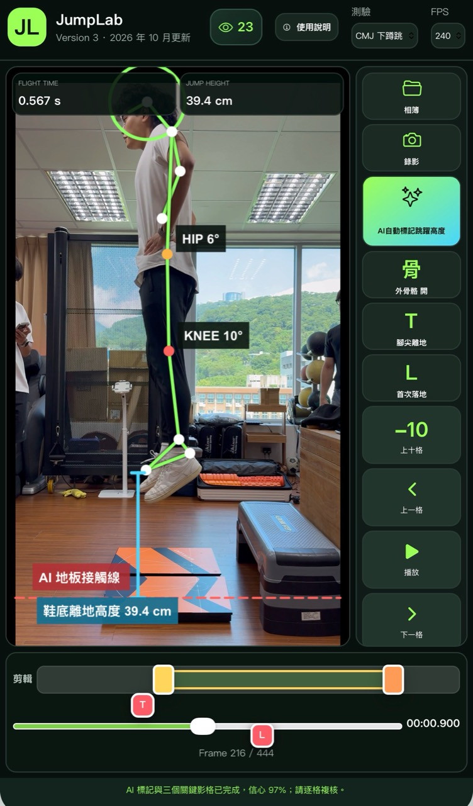
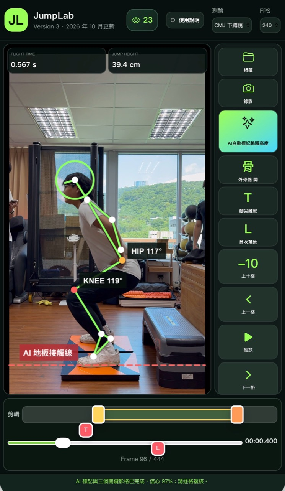
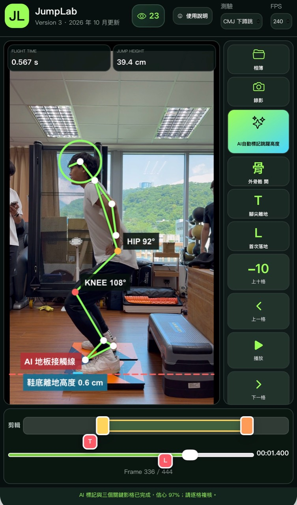
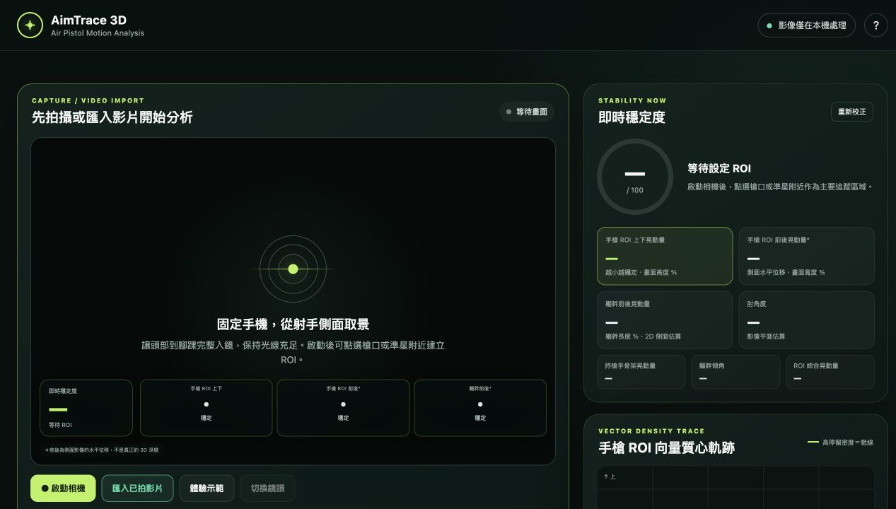

# Video Motion Analysis

Practical video-based motion analysis demos for sports performance, coaching, and teaching.

This repository is a visual portfolio and project directory. Each application remains independently maintained and deployed, so updates here do not change the existing Firebase sites.

## Demos

| Project | What it does | Analysis approach | Status |
| --- | --- | --- | --- |
| [JumpLab](./jumplab/) | Reviews jump video, marks take-off and landing events, and estimates flight time, jump height, and movement landmarks. | Local video, frame-by-frame event review, and on-device pose estimation | Prototype / Coach-support demo |
| [Air Pistol Motion Analysis](./air-pistol-motion-analysis/) | Visualizes selected-region sway, shooting posture, motion traces, and synchronized 3D review. | ROI tracking and single-camera pose visualization | Prototype / Coach-support demo |

## JumpLab V3

Video-based CMJ, SJ, and DJ review with AI-assisted event marking, pose overlays, frame-by-frame controls, and manual verification of take-off and landing events.

<table>
  <tr>
    <td width="33%"></td>
    <td width="33%"></td>
    <td width="33%"></td>
  </tr>
  <tr>
    <td align="center"><strong>Take-off</strong> Flight-time and jump-height estimate</td>
    <td align="center"><strong>Countermovement</strong> Hip and knee angle review</td>
    <td align="center"><strong>Landing</strong> Floor-contact and landing review</td>
  </tr>
</table>

[View project details](./jumplab/) · [Open JumpLab V3 demo](https://jumplab-tehta.web.app/v3) · [Source repository](https://github.com/skyfu218/jumplab-motion-analysis)

## Air Pistol Motion Analysis

Local-first motion review for aiming stability, ROI movement traces, posture visualization, and coach interpretation.

[View project details](./air-pistol-motion-analysis/) · [Open live demo](https://air-pistol-3d-skyfu218.web.app/) · [Source repository](https://github.com/skyfu218/air-pistol-3d-motion-analysis)

## Measurement and privacy notes

- These tools support teaching, movement review, and coaching conversations; they are not medical devices or official judging systems.
- Single-camera pose, depth, angle, distance, and stability values are estimates affected by camera position, frame rate, lighting, occlusion, and model confidence.
- Event suggestions and automated outputs require human review.
- Video processing is designed to remain on the user's device unless a project page explicitly states otherwise.

## About

Created for sports-science teaching and applied motion-analysis exploration.

