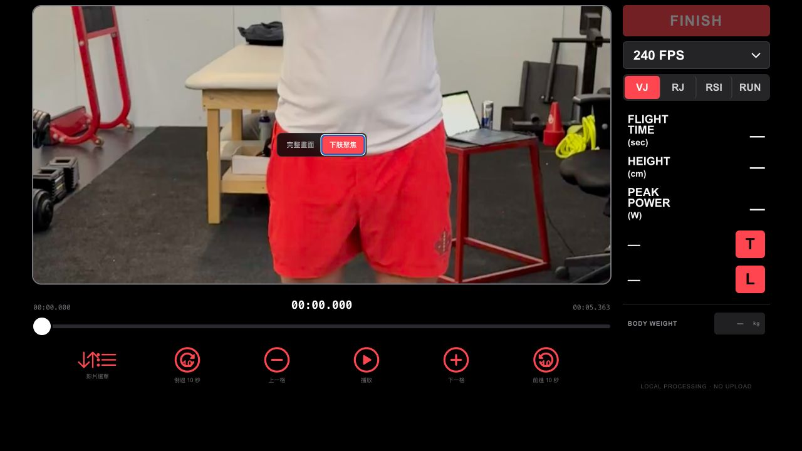

# JumpLab

JumpLab is a video-based jump-analysis workflow for CMJ, SJ, and DJ review. It combines video playback, frame-level event marking, estimated performance metrics, and on-device pose overlays to support teaching and coach review.

## What it demonstrates

- Local video import and original-aspect-ratio playback
- Frame-by-frame review at the selected video frame rate
- Take-off and landing event marking for CMJ and SJ
- Contact, take-off, and landing event marking for DJ
- Estimated flight time, jump height, contact time, and RSI
- On-device pose overlay and coach-facing report workflow
- Manual verification of AI-suggested event points

## Project links

- [Live demo](https://jumplab-tehta.web.app/)
- [Source repository](https://github.com/skyfu218/jumplab-motion-analysis)

## Measurement boundary

Jump height may be estimated from flight time, and event timing depends on the source video's true frame rate and the reviewer-selected frames. Pose landmarks and floor contact are 2D image estimates. Results should be interpreted as teaching and coach-support information, not as force-plate validation, medical diagnosis, or an official performance standard.

[Back to Video Motion Analysis](../README.md)

